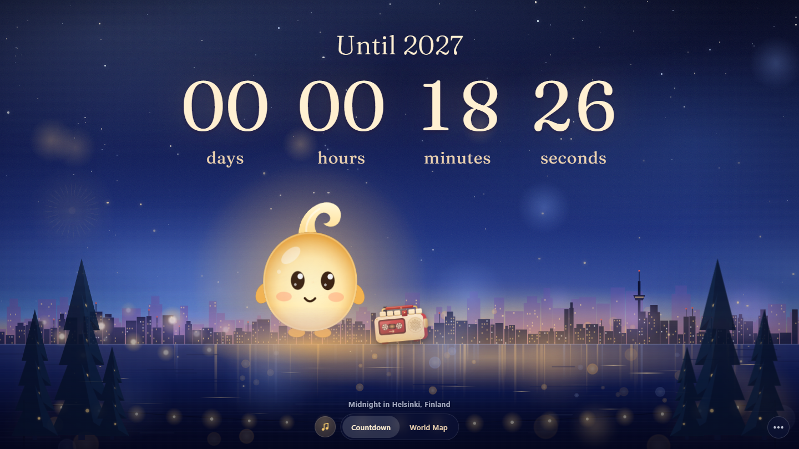

# New Year Countdown

A live countdown to New Year for phones, desktops and large fullscreen displays, set in a cinematic midnight city and guided by Omid, a small glowing spirit whose name means "hope" in Persian. It follows the time zone of the city you choose, shows New Year arriving around the world on a map, and ends in a fireworks celebration at midnight.

[View the live site](https://newyear.seerat.me)

## Preview



*The countdown, set for Helsinki.*


*Christmas mode, shown from 24 to 26 December.*

## Features

- Live countdown to the next 1 January, for your device's time zone or any listed city
- World map showing where New Year has arrived, is being celebrated now, and is coming next
- Midnight fireworks and celebration sequence, with a recorded countdown and greeting
- Omid, an animated mascot you can tap and drag, and his cassette player
- Background music with a mute control, and a Christmas playlist in Christmas mode
- Christmas mode with snow, decorated trees and a scarf for Omid
- Interface in 25 languages, including right-to-left layouts
- Installable, works offline after the first visit, and respects reduced-motion settings

## Tech

React, TypeScript, Vite, Tailwind CSS, Oxlint. Animation is CSS and SVG, the world map is drawn without a map library, and the offline service worker is hand-written (no PWA plugin). The Fraunces font is self-hosted.

## Running locally

```
npm install
npm run dev
```

The background music is not in the repository. Copy `.env.example` to `.env.local` and set `VITE_AUDIO_BASE_URL` to the public base URL of the audio storage; without it the music will not load.

Other scripts: `npm run build` (type-check and production build), `npm run preview` (serve the build) and `npm run lint`.

## Audio credits

Music and sound effects come from Mixkit and Pixabay. Tracks, creators and sources are listed in [docs/audio-sources.md](docs/audio-sources.md).
